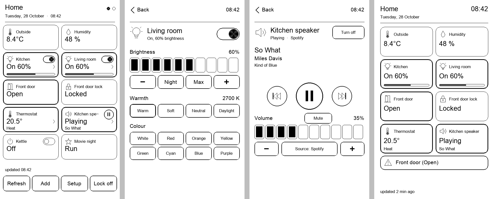
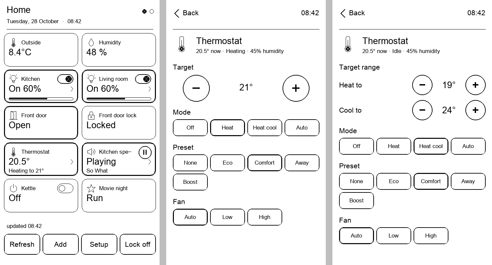

# Home Assistant for the Xteink X4 Pro

A [Home Assistant](https://www.home-assistant.io) panel for the **Xteink X4 Pro** e-reader, running
as a mini app on its stock **XTOS Licorice** firmware. Your sensors at a glance; lights, speakers,
thermostats, covers, scenes and locks a tap away; and, if you like, the panel as the reader's lock
screen.

No custom firmware and no flashing: you copy one file to the SD card and install it from the
reader's own file browser.



*From left to right: the panel, a light's controls, a speaker's controls, the lock screen.*

- [What it does](#what-it-does)
- [Install](#install)
- [Connect it to Home Assistant](#connect-it-to-home-assistant)
- [Use](#use)
- [The lock screen](#the-lock-screen)
- [Files on the SD card](#files-on-the-sd-card)
- [Troubleshooting](#troubleshooting)
- [Build from source](#build-from-source)
- [How it works](#how-it-works)
- [Caveats](#caveats)
- [License and credits](#license-and-credits)

## What it does

| entity | on the tile | a tap | its controls |
|---|---|---|---|
| light | on / off, brightness bar | the switch toggles; the rest opens the controls | brightness in ten steps, − / Night / Max / +, warmth (Warm, Soft, Neutral, Daylight), eight colours, as far as the light supports them |
| media player (smart speaker, TV) | state, what is playing | the button plays / pauses; the rest opens the controls | previous / play-pause / next, volume in ten steps and − / +, mute, source (Spotify, TV, ...), on / off, as far as the player supports them |
| climate (thermostat, radiator valve, air conditioner) | current temperature; heating / cooling and the target | opens the controls | target temperature − / + (or the low and high ends of a heat/cool range), the modes (heat, cool, heat/cool, auto, off, ...), presets (eco, comfort, away, boost, ...), fan modes; current humidity |
| cover (blinds, garage door) | open / closed and position | opens the controls | open, stop, close, position in ten steps |
| switch, fan, input boolean, automation | on / off | toggles | |
| scene, script, button | | runs / presses | |
| lock | locked / unlocked | asks, then locks or unlocks | |
| sensor, binary sensor, person, ... | the value with its unit, Open / Closed, Home / Away, ... | shows the details | |

Every tile has an icon for its kind (bulb, thermometer, humidity drop, door, window, lock,
speaker, ...). Tiles that are on, open, unlocked or at home get a heavy frame. Ten tiles fit on a
page; swipe or use the side buttons for the next one.

## Install

You need an **X4 Pro** on **XTOS Licorice** (Settings → About shows "XT Licorice ..."), Wi-Fi on the
reader, and a Home Assistant the reader can reach.

1. Download `homeassistant.xtapp` from the [latest release](../../releases) (or
   [build it yourself](#build-from-source)).
2. Put the reader in **USB mode** (side drawer → USB mode) and copy the file to the **root of the
   SD card**. Eject and leave USB mode.
3. On the reader open **All Files**, tap `homeassistant.xtapp` and confirm **Install this
   package?**. The toast **Installed** appears.
4. Unlock the hidden app menu, once: **Settings → About → tap "Model" ten times**, each tap less
   than two seconds after the previous one. Nothing is shown, but the side drawer (≡) now has an
   **Ink App** row between Cloud and USB mode.
5. **≡ → Ink App → Home Assistant** starts it. The **Home pad** under the screen asks "Leave app"
   to return.

**Updating:** install the new `.xtapp` the same way, over the old one. Your settings and tiles stay.
Do not uninstall first: uninstalling deletes the app's folder with your settings.

## Connect it to Home Assistant

You need the address of your Home Assistant and a **long-lived access token**.

1. In Home Assistant open your **profile** (your name, bottom left) → **Security** tab →
   **Long-lived access tokens** → **Create token**. Give it a name ("Xteink") and copy it.
   Use the token of an **administrator** account if you can: see
   [Admin or not](#admin-or-not).
2. Enter both, either way:
   - **On the reader:** the app opens on **Setup**. Tap **Address** and type it, e.g.
     `http://192.168.1.20:8123`; tap **Token** and type it (the field takes up to 400 characters);
     tap **Test**. "Connected." means it works.
   - **Over USB** (easier for a 180-character token): create a text file `ha.txt` with

     ```
     url=http://192.168.1.20:8123
     token=eyJhbGciOiJIUzI1NiIsInR5cCI6...
     title=Home
     ```

     and copy it into `XTApps/homeassistant/files/` on the SD card (the folder exists once the
     app has been opened). `title` is the heading of the panel.
3. **Use the IP address**, not `homeassistant.local`: the reader most likely cannot resolve
   `.local` names. A Nabu Casa address (`https://xxxx.ui.nabu.casa`) or any other HTTPS address
   works too.

### Admin or not

The app fetches every tile in **one** request through Home Assistant's template API, which only
accepts an administrator's token. With any other token it notices, and falls back to one request per
tile: everything still works, only refreshing takes longer (about 1.5 s per tile), and **Add**
cannot search, so you list the tiles in `tiles.txt` instead.

## Use

### Adding tiles

Tap **Add**, type part of a name or an entity id (`kitchen`, `light.`, `temperature`), and tap the
entities you want: `[x]` marks the ones on the panel, a second tap takes one away. Swipe for more
results, **Search again** for another word, **Done** to go back.

Or write the list yourself in `tiles.txt` (see [Files on the SD card](#files-on-the-sd-card)).

### The panel

- **Tap** a tile as in the table above. Covers, locks and anything that is not a toggle never act
  by accident: locks ask first, covers and lights' colours are on their own screen.
- **Long press** a tile to move it back or on, rename it, pin it to the lock screen, or remove it.
- **Refresh** asks Home Assistant now. While the panel is open it also asks every minute; "updated
  hh:mm" at the bottom says when it last did, "(old)" when that is over ten minutes ago.
- **Setup** changes the address, the token or the title.
- **Lock** / **Lock off**: see [the lock screen](#the-lock-screen).

### The controls of a light, a speaker, a thermostat, a cover

A tap on such a tile (outside its switch or play button; the `›` marks these tiles) opens its
controls. **Back** at the top left, the Back side button or a swipe to the right returns to the
panel. A change shows at once and is confirmed by Home Assistant's answer a moment later; if it
fails, the screen says so and shows the real state again. Several quick taps (volume up, up, up)
are not lost: the latest one is sent as soon as the one before is done.

Only the controls an entity supports are shown or active: a plain on/off bulb has no brightness, a
speaker that cannot be switched off has no Turn off.

**Thermostats.** The tile shows the room temperature and, below it, what the thermostat is doing:
"Heating to 21°", or the mode and target ("Heat · 21°", "Heat cool · 19-24°") while it waits. Its
controls show the target with − / + in the thermostat's own steps (usually 0.5°), never past its
minimum and maximum. In heat/cool (or auto) mode a thermostat has two targets: **Heat to** and
**Cool to** are set separately and are always sent together, as Home Assistant needs; they cannot
cross. Below come the modes, the presets (Eco, Comfort, Away, Boost, as your thermostat names them)
and the fan modes of an air conditioner; the active one has a heavy frame.



## The lock screen

**Lock** on the panel makes the app the reader's lock screen (the firmware asks once; in
Settings → Display the "Off wallpaper" must be **Default**). It shows:

- the time and date, redrawn every minute;
- up to eight tiles: the ones you pinned (long press → **Pin to lock**, or a `*` in `tiles.txt`),
  or, when none is pinned, the first eight;
- a box listing every open door or window, water or smoke alarm, unlocked lock and open garage
  among **all** tiles, or "All doors and windows closed."

When the states are older than ten minutes the lock screen asks Home Assistant again, if the reader
lets a locked app use the network; "updated ... min ago" at the bottom tells you how fresh they are.
**Lock off** gives the lock screen back to the firmware.

## Files on the SD card

All in `XTApps/homeassistant/files/`, plain text you can edit on a computer:

| file | what |
|---|---|
| `ha.txt` | `url=`, `token=`, `title=`, `lock=` (true while the app is the lock screen) |
| `tiles.txt` | the tiles, in order: one entity a line |
| `states.txt` | the last states, so the panel and the lock screen open at once; written by the app |

`tiles.txt`:

```
# one entity a line: "entity_id" or "entity_id = Label"; a "*" in front puts it on the lock screen
*sensor.outdoor_temperature = Outside
*binary_sensor.front_door
light.kitchen = Kitchen
media_player.living_room_speaker
climate.living_room
scene.movie_night
```

The token in `ha.txt` gives full access to your Home Assistant: keep the SD card to yourself, and
delete the token in your Home Assistant profile if the reader gets lost.

## Troubleshooting

| you see | what to do |
|---|---|
| `Connection failed: no answer` or `Could not ask` | Wi-Fi on? The address reachable from the reader's network? Use the IP address, not `.local`; include `http://` and the port (`:8123`). |
| `token rejected (401)` | The token was mistyped or deleted. Create a new one; copying `ha.txt` over USB avoids typos. |
| `not found (404): is the address right?` | The address points somewhere that is not Home Assistant's API, e.g. a reverse proxy path. |
| `Search needs an admin's token` | See [Admin or not](#admin-or-not); add tiles in `tiles.txt`. |
| A tile shows `-` and `unavailable` | Home Assistant has no state for it right now (device offline), or the entity id is wrong. |
| `Install failed` when installing | The package does not match your firmware's key: see [Caveats](#caveats). |
| `App error, closed` | Please open an issue with your firmware build (Settings → About) and what you did. |
| No **Ink App** row in the drawer | Repeat the ten taps on "Model" a little faster. |

## Build from source

Requirements: Python 3.10 or newer.

```bash
python -m venv .venv
.venv/bin/pip install -r requirements.txt
.venv/bin/python build.py --test
```

The package lands in `dist/homeassistant.xtapp`. `build.py` bundles the sources, checks them with
a Lua 5.5 lint and compiler (the reader runs Lua 5.5, which rejects at load time some code that
other Lua versions accept, and then only says "App error, closed"), runs the offline tests with
`--test`, and packs the result.

The offline tests (`homeassistant/test_homeassistant.py`) run the app under Lua 5.4 against a
stand-in Home Assistant that renders the app's templates with Jinja2, the engine Home Assistant
uses: setup, adding tiles, every kind of tile, the controls, queued taps, the fallback for
non-admin tokens, errors and the lock screen.

### Project layout

```
homeassistant/            the mini app
  manifest.json           name, version, permissions (net), lock-screen entry
  src/main.lua            the app: panel, controls, setup, input
  src/ha.lua              Home Assistant: settings, requests, parsing, how a state is shown
  src/draw.lua            drawing: rounded frames, icons, switch, buttons, bars, glyphs
  src/lock/lock.lua       the lock screen
  bundle.py               src/ -> index.lua and lockscreen.lua (generated: edit src/, not these)
  test_homeassistant.py   the offline tests
  icon.png                the icon in the Ink App grid (tools/make_icon.py draws it)
build.py                  bundle, check, test, pack
xtpack.py                 packs and encrypts an app folder as .xtapp
tools/                    the bundler, test harness and Lua 5.5 lint (see NOTICE.md)
```

The reader has no `require` for files inside a package, so `bundle.py` puts the modules and the
shared kit (`tools/gamekit/gamekit.lua`) into one `index.lua`; the lock screen loads on its own and
gets its own copy of `ha.lua` and `draw.lua`.

### Contributing

Fork it, change it, send a pull request, or keep your fork: the [MIT License](LICENSE) allows all of
it. Please run `python build.py --test` before sending changes, and keep the drawing light: the host
draws at most about 1024 commands a screen (the tests check the count), and large black areas
ghost on e-ink.

## How it works

- **Talking to Home Assistant.** Its REST API with the long-lived token as a Bearer token. The
  states of all tiles come in one `POST /api/template` that renders a short line per entity: every
  HTTPS request costs about 1.4 s on the reader and the app has about 1 MB of memory, so it never
  loads `/api/states` (every entity in the house as JSON). A control screen loads its one entity
  with `GET /api/states/<entity_id>`. Actions are `POST /api/services/<domain>/<service>`; Home
  Assistant answers with the states that changed, so the screen updates without asking again.
- **Drawing.** The mini-app API draws lines, polylines, circles, rectangles and text in black on
  white. Rounded frames and icons are polylines; nothing large is filled black.
- **The device.** The mini-app host, its API (version 2.9 for apps that declare `"api": "2.0"`)
  and the package format are unofficial: they were reverse-engineered in
  [touch-licorice-apps](https://github.com/omer-faruq-xteink/touch-licorice-apps), whose
  [firmware notes](https://github.com/omer-faruq-xteink/touch-licorice-apps/blob/main/docs/firmware-notes.md)
  describe them.

## Caveats

- **Unofficial.** Xteink has not published this API. Nothing here touches the firmware itself,
  but installing what the manufacturer did not provide is at your own risk.
- **Firmware-bound.** Packages are encrypted for a key that XTOS Licorice carries; it worked on
  build 26102301 (October 2026). If an update rotates the key, packages stop installing until
  rebuilt (`python build.py --image <app image>`, see `xtpack.py`).
- **Tested so far:** version 0.1 on an X4 Pro; versions 0.2 and 0.3 (the new design, the controls, thermostats) only
  with the offline tests. Other Xteink models are untested.
- **Network.** The app talks only to the address you enter.

## License and credits

[MIT](LICENSE): anyone may use, copy, change, fork and share this, also commercially, as long as
the license notice stays with it.

Built on the reverse engineering and tools of
[omer-faruq-xteink/touch-licorice-apps](https://github.com/omer-faruq-xteink/touch-licorice-apps)
and [kycube/x4pro-emu](https://github.com/kycube/x4pro-emu), both MIT; see [NOTICE.md](NOTICE.md).
Not affiliated with Home Assistant, Nabu Casa or Xteink.
